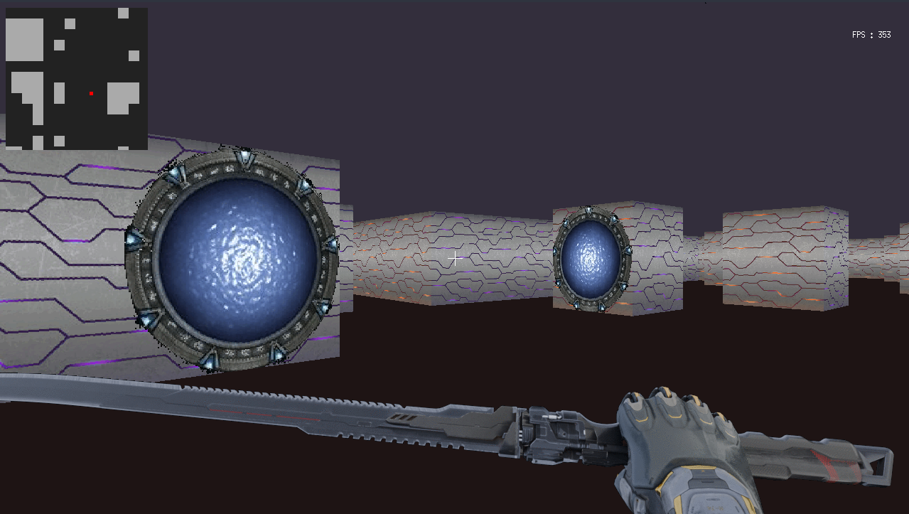

# Cub3d

> A handmade, CPU-only raycaster written in C: Doom-style rendering with Portal-style portals (without see-through rendering).




## About

**Cub3d** is a software renderer built from scratch in C. It uses raycasting to draw a pseudo-3D world in the spirit of _Doom_ / _Wolfenstein 3D_, and adds **portals** inspired by Valve's _Portal_: walk through one, and come out of its linked twin, unfortunately without the view rendered through it in real time. (might look into it later)

Everything runs on the **CPU only**: no OpenGL, no Vulkan, no GPU shaders. The goal was to understand how rendering works at a low level and to **learn code optimization** (see [Optimization](#optimization)) by pushing a software renderer as far as possible.

This was developed as a school project at **42Lyon Auvergne Rhône-Alpes** (2025).

## Features

- [x] Raycasting engine (DDA algorithm) with textured walls
- [x] Floor and ceiling coloring
- [x] Portals: linked pairs, portal traversal
- [x] Smooth player movement and collision detection
- [x] Different animations: walking, sprinting, idling, inspecting, attacking (on a wall to create a portal), blocking, and a secret afk animation after some time
- [x] Fully customisable maps: A simple file with 4 XPM textures for walls, and 1 and 0 for walls and floors
- [x] If you don't want to create your own map you can use `make play` and enter width and height to make a random map for it

## Getting Started

### Prerequisites

- A C compiler (`gcc` or `clang`), X11 development headers (`libx11-dev` and `libxext-dev`)
- `make`
- The graphic library used `minilibX` is statically linked to the executable so no need to install it

Tested on Linux only

### Build & Run

```bash
git clone https://github.com/Onhix973/Cub3d.git
cd Cub3d
make
./Cub3d maps/default.cub
make play #to create a random map
```

| Command       | Description                                                       |
| ------------- | ----------------------------------------------------------------- |
| `make`        | Build with only the raycaster, no additional features             |
| `make bonus`  | Build with all of the features                                    |
| `make clean`  | Remove build files                                                |
| `make fclean` | Remove build files and the executable                             |
| `make play`   | Creates a random map and launch the game with all of the features |

## Controls

| Key                                   | Action                               |
| ------------------------------------- | ------------------------------------ |
| `W` `A` `S` `D`                       | Move                                 |
| `LShift`                              | Sprint                               |
| `←` `→` / Mouse (if locked)           | Rotate camera                        |
| `C` / `V`                             | Lock/Unlock Mouse                    |
| `E` / `Left Click` (if mouse locked)  | Place portal (and attack animation)  |
| `Q` / `Right Click` (if mouse locked) | Block animation (unfinished feature) |
| `R`                                   | Reset all the portals                |
| `L`                                   | Inspect animation                    |
| `Esc`                                 | Quit                                 |

## How It Works

### Raycasting

- For each screen column, a ray is shot from the player in the direction the player is looking
- Using the DDA algorithm, we look for an intersection with a wall
- The distance between the wall and the player determines the height of the slice we will draw on the screen

Using the raw Euclidean distance to the wall creates a fisheye effect: outer rays travel farther than the central one, so walls at the edges are drawn too short and look curved. To fix this, the player’s view is modeled as a flat camera plane perpendicular to the direction vector, and the perpendicular distance to the wall is used instead of the ray’s real length

### Texture Mapping

- After detecting a wall at a certain distance, we need to choose which column of the texture to draw in this screen column
- Fortunately, we have a map composed as a grid, and walls can be only on segments of this grid
- Based on the impact coordinates of the ray with the wall we can know where the ray hits the wall
- With that we can map the texture to this wall and see which pixel slice needs to be drawn

### Portals

- A portal is coded as an instantiated struct that stores some data:

| Variable                    | Use                                                                                             |
| --------------------------- | ----------------------------------------------------------------------------------------------- |
| `mapX`/`mapY`               | Map coordinates, stored as int (basically on what wall face is the portal placed)               |
| `worldX`/`worldY`           | Actual world coordinates, stored as float, used to compute teleportation logic and normals      |
| `facing`/`graphical_facing` | The face the portal is on, and its opposite, to see which 'way' the portal is 'looking'         |
| `active`                    | A boolean to know the activation state of the portal                                            |
| `virtual_cam`               | A Player struct to simulate the player behavior on the other end of the portal when teleporting |

- The Game stores two portal structs, A and B, there can be only two portals at the same time
- The player is teleported when the center of its hitbox crosses the portal, the orientation of the teleporting player is computed based on the direction vector of the player and the normal vector of the portal

## Optimization

Since the goal was to learn optimization on the CPU, here is what I did, and what it gained

### What I did

- **Image buffer instead of per-pixel calls:** the whole frame is written into one MiniLibX image buffer, then pushed to the window once, instead of calling `mlx_pixel_put` for each pixel
- **Textures as raw pixel arrays:** textures are loaded once at startup into `int` arrays, so reading a texel is a plain array access
- **Prebuilt floor/ceiling buffer:** the background (ceiling color on top, floor color below) is built once at startup. Each frame starts from a copy of it, and only the walls are drawn on top
- **Cheaper math:** used perpendicular distance (no sqrt needed), replaced divisions with multiplications, and replaced multiplications with bitshifts where possible
- **Compiler flags:** `-O3`

### Results

| Change                          | FPS | Notes    |
| ------------------------------- | --- | -------- |
| Naive version (`mlx_pixel_put`) | 60  | Baseline |
| + Image buffer                  | 120 |          |
| + Prebuilt floor/ceiling buffer | 220 |          |
| + Cheaper math                  | 250 |          |
| + Compiler flags                | 300 |          |

Measured at 1280x720 on `Intel Core i7-12700`, averaged over 250 frames

### What I learned

- The image buffering for the whole frame and for ceiling and floor colors was the biggest improvement I discovered
- I also learned how replacing division by multiplication and even some multiplication by bitshifting was surprisingly efficient (before using the `-O3` flag)
- XPM is not the best format to store big images like animation sheet, storing each pixel as a character with no compression is the bottleneck

## Map Format

Maps are defined like this:

- The file extension of the map must be `.cub`

- The first four lines are the wall textures, each one contains an identifier and a path to an .xpm texture (due to mlx limitation, .xpm is the only supported format)
- The next two lines are the color settings for the floor and ceiling, those settings are rgb codes written as: rrr,ggg,bbb
- After those configuration lines, there is the map, any error in it will be flagged by the parser

```
NO textures/NO.xpm
SO textures/SO.xpm
WE textures/WE.xpm
EA textures/EA.xpm
F 220,100,0
C 225,30,0

        1111111111111111111111111
        1000000000110000000000001
        1011000001110000000000001
        1001000000000000000000001
111111111011000001110000000000001
100000000011000001110111111111111
11110111111111011100000010001
11110111111111011101010010001
11000000110101011100000010001
10000000000000001100000010001
10000000000000001101010010001
11000001110101011111011110N0111
11110111 1110101 101111010001
11111111 1111111 111111111111
```

| Identifier/Symbol | Meaning                               |
| ----------------- | ------------------------------------- |
| `NO`              | North oriented wall texture           |
| `SO`              | South oriented wall texture           |
| `WE`              | West oriented wall texture            |
| `EA`              | East oriented wall texture            |
| `F`               | Floor rgb color                       |
| `C`               | Ceiling rgb color                     |
| `1`               | Wall                                  |
| `0`               | Empty space                           |
| `N`/`E`/`S`/`W`   | Player position and orientation start |

Spaces are treated as empty void outside the map. The playable area must be fully enclosed by walls

## Known Issues / Limitations

- Performance is CPU-bound and scales with resolution
- The use of XPM format for textures makes the startup loading of those a bit slow, especially for animation sheets

## Possible Improvements

- Z-buffer and real time recursive rendering through portals
- Draw two pixels instead of one when possible (a wall texture usually has multiple pixels of the same color next to each other)

## Resources & Inspiration

- [Lode's Computer Graphics Tutorial: Raycasting](https://lodev.org/cgtutor/raycasting.html)
- [Wolf3d source code](https://github.com/id-Software/wolf3d)
- [Example of a portal raycaster in Kotlin, made by gh123man](https://github.com/gh123man/Portal-Raycaster)

## Authors

- **Thyanouï Lutz**: [@Onhix973](https://github.com/Onhix973) (rendering and game logic)
- **Alexandre Bonifacio**: [@AlexBonifacio](https://github.com/AlexBonifacio) (beautiful map parser and random map generator)

## Credits

- The wall textures were made by Alexandre Bonifacio ([@AlexBonifacio](https://github.com/AlexBonifacio)).
- The animations are a sprite sheet I built myself: I animated Ghostrunner (a game I love) models in Blender and rendered them in front of a green screen, a bit like filming the game's animations. The game's models are not part of this repository, only the frames I rendered from them.
- The graphics library used for the window and image handling, MiniLibX (MLX), is provided by 42.

## License

The source code of this project is distributed under the MIT License. See the [`LICENSE`](LICENSE) file for details.

The animation sprite sheet is derived from content from _Ghostrunner_ and is **not** covered by this license. It remains the property of its respective owners.

> Note: _Doom_ and _Portal_ are trademarks of their respective owners. This project is an independent, educational work and is not affiliated with id Software, Valve, One More Level, or any related company.
